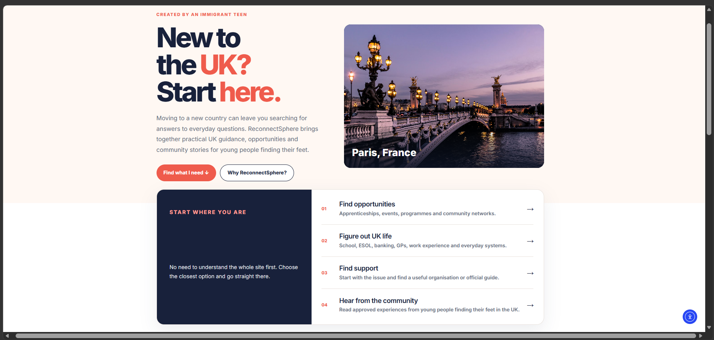
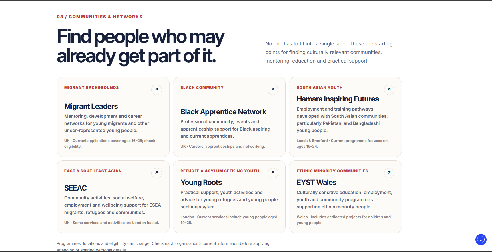
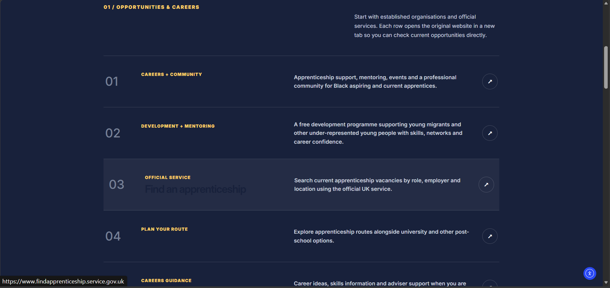
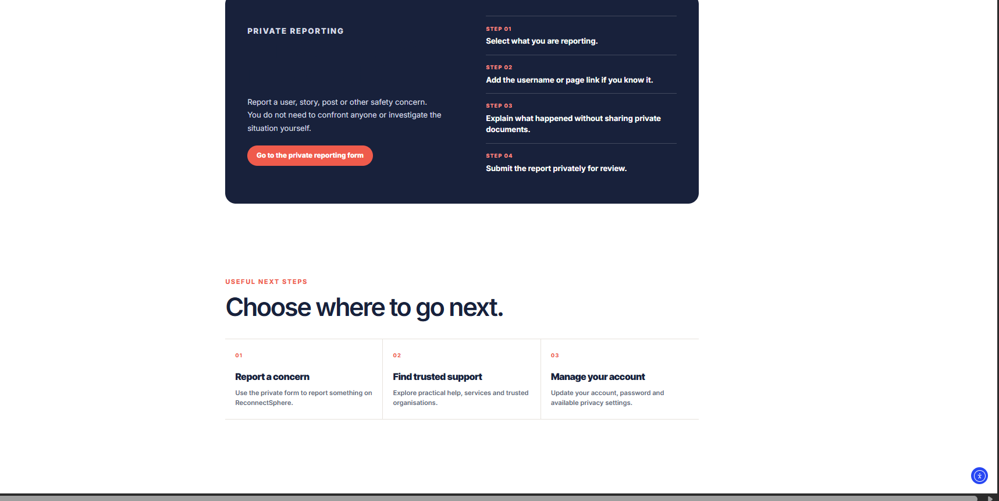
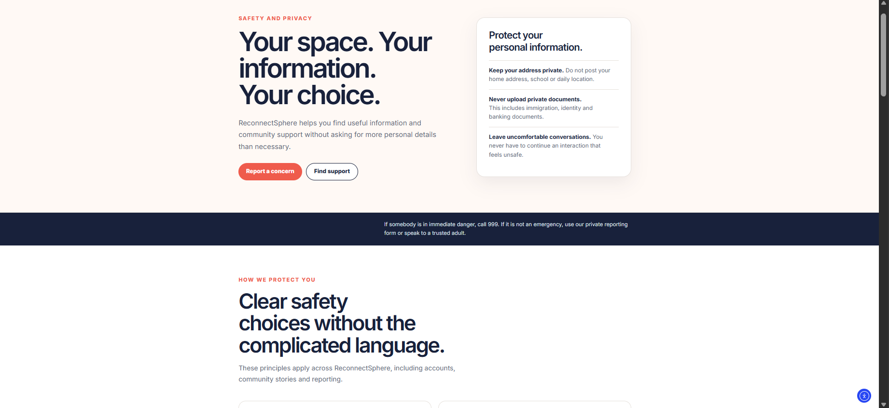

# ReConnectSphere

Independent CREST Gold Project 
**Live Website:** [Visit ReConnectSphere](https://reconnectsphere.com)
September 2025 – Present

## Overview

ReConnectSphere is a support website designed to help young people who have recently moved to the UK navigate everyday life, education and social connections.

## Research

- Collected 141 responses to an initial questionnaire.
- Conducted a second questionnaire with 10 first-generation immigrant respondents.
- Completed six semi-structured interviews.
- Analysed findings to identify challenges and support needs.

## Design and Development

- Translated research findings into website requirements.
- Designed page layouts and wireframes using Figma.
- Developed the website using WordPress.
- Refined content and layouts based on research and feedback.

## Project Learning

This project has developed my experience in user research, requirements gathering, digital design, website development and independent project management.

## Project Documentation

The following documents provide further detail about the research, planning and evaluation behind ReConnectSphere.

- [Research Summary](Research-Summary.md)
- [Website Requirements](Website-Requirements.md)
- [Design Decisions](Design-Decisions.md)
- [Testing and Evaluation](Testing-and-Evaluation.md)

## Website Screenshots

### Homepage

### Community

### Opportunities

### Report a Concern

### Safety and Privacy

