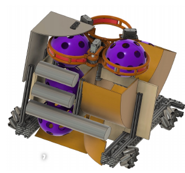
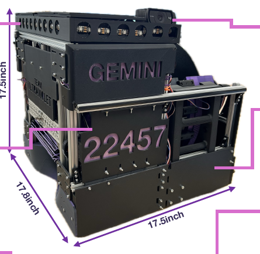

# FIRST Tech Challenge Robotics | Team Ultraviolet

**Team:** Ultraviolet, Team 22457 (UK Team 456)  
**School:** Bournemouth School for Girls  
**Season:** 2025/26 DECODE  
**Robot:** Gemini

## Project overview

I was part of Team Ultraviolet, an all-girls FIRST Tech Challenge team. We designed, built and developed Gemini for the 2025/26 DECODE season. The robot combined a mecanum drivetrain, an intake and spindexer for handling game artefacts, and a dual-direction flywheel launcher.

## My contribution

The team engineering portfolio lists me as an engineer and names me as one of the section leads, alongside Aanya, for the dual launcher. The section documents the team's design and development work, including early CAD concepts, prototyping and redesign.

## Dual launcher: design process

- The initial concept used a flywheel launcher. The team built an adjustable MDF rig to explore launch angles and test the path of the artefacts.
- Early prototyping showed that small differences in the launcher channel could affect whether an artefact travelled through the mechanism successfully, making accurate dimensions important.
- The initial CAD concept did not allow the launch angle to be adjusted mechanically. The team therefore developed a bidirectional design with independently adjustable launcher hoods, allowing the robot to launch in either direction and at different angles.
- The team iterated the design to fit the robot's size constraints and produced the required 3D-printed parts.

## What I learned

This project strengthened my understanding of iterative design, communicating engineering decisions and working within physical constraints. It also showed the value of prototyping: testing an early concept helped the team identify limitations before committing to the final mechanism.

## Visual evidence

### Early launcher CAD concept

### Gemini final robot

## Team context and source

These images and the project description are drawn from Team Ultraviolet's 2025/26 engineering portfolio. They show team work and should not be interpreted as claiming that I designed or built every part of the robot independently.

**Portfolio:** Team Ultraviolet, Team 22457, *Engineering Portfolio 2025/26*, especially the dual launcher section and final robot overview.
